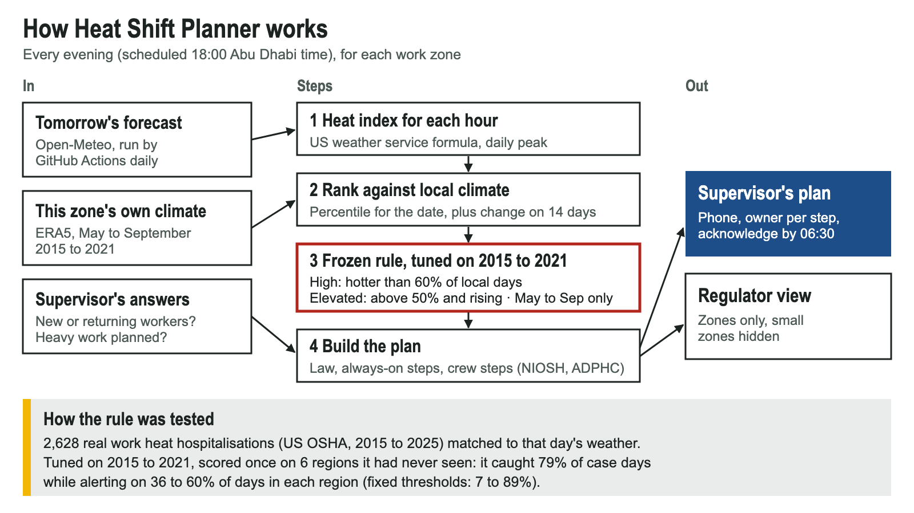

# Heat Shift Planner (working name)

Future Health Digital Innovation Challenge (Abu Dhabi) · Challenge 06: Population and Workforce Health Early Warning.

**Try it (no login): https://drahmed7887.github.io/hack-future-health/** · In November, tap "Replay a day" to see a real summer day:
alerts run May to September only.



The evening before a shift, a site supervisor in Abu Dhabi sees three things for tomorrow:
1. **What the law already requires** (UAE midday break; the ADPHC rule that a heat stress programme applies at 35 °C or more).
2. **Whether tomorrow is hotter than most days for that place and time of year**, using a rule tested on real heat hospitalisations.
3. **A plan for their crew**: new or returning workers and heavy work change the steps, each with an owner and a source.

The regulator sees zones, never people. Nothing in the app clears anyone to work.

> This README is the single source for every claim. Slides, submission text and the video are made from it, and every number
> below comes from a script output in `results/`.

## Why a new rule was needed

A fixed heat trigger fails in both directions. The common US trigger (heat index ≥ 80 °F) alerted on **93 %** of summer days in
the original 8 test regions and **82 %** in 6 unseen ones: an alert that rarely switches off. A threshold tuned on Texas and Florida would put **every Abu Dhabi day from
June to September** in its top tier (`docs/g1_results.md`, transfer check). Heat-health research sets thresholds relative to
local climate because people adapt to their usual heat (Anderson & Bell 2009, PMID 19194300; Gasparrini et al. 2015,
PMID 26003380). So each zone gets thresholds from its own weather history.

## The rule (frozen before scoring)

Alert when the heat index is at least 80 °F **and** tomorrow is hotter than the zone's 60th percentile for that time of year
(**High**), or hotter than its 50th percentile and at least 3 °F above the previous 14 days (**Elevated**). Percentiles come from
each place's own 2015–2021 weather (ERA5). Model tiers run **May to September only**, the season it was tested on.
Code: `heatwarn/relative.py`; frozen parameters `results/frozen_params_r4.json`.

## How it was tested

No public data on work-related heat illness exists for Abu Dhabi. The closest real record is **US federal OSHA's Severe Injury
Reports**: 2,628 work-related heat hospitalisations, January 2015 to November 2025, with date and location. Each was matched to
that day's weather. Rules were tuned on 2015–2021, committed, and scored once on later data. Every step was pre-registered
(`docs/backtest_protocol.md`, `docs/protocol_v3_relative.md`), including expected results and one logged amendment.

**Transfer test: 6 US regions never used in tuning, 2022–2025** (86 days with a reported heat hospitalisation; `results/holdout_results.json`)

| Rule | Days with a reported case that got an alert (95 % CI) | Share of days alerted |
|---|---|---|
| Fixed heat index ≥ 80 °F | 98.8 % (95.8–100) | 82 % |
| Calendar (15 Jun–15 Sep) | 76.7 % (65.8–86.0) | 61 % |
| Fixed thresholds tuned in TX/FL | 70.9 % (57.1–82.1) | 40 % |
| **Relative rule (this app)** | **79.1 % (69.6–87.9)** | **49 %** |

- Alert load stayed in a **25-point band** across cool and hot cities (36–60 % of days) with the relative rule, against
  **82 points** (7 % in Pittsburgh to 89 % in McAllen) with fixed thresholds. The pre-registered success criterion was met.
- The sensitivity gain over fixed thresholds (+8.1 points, 95 % CI −6.9 to +24.3) is **not statistically clear**.
- Within the climates it was tuned on, fixed thresholds did better (training sensitivity 78.4 % vs 67.4 %).

**Forecast the evening before** (8 original regions, 2024–2025, the years with archived 24-hour humidity forecasts; every input
available at 18:00 the day before): the deployed rule gave the same decision as observed weather on **84 %** of region-days.
The forecast ran warm, so it alerted on more days (59 % vs 51 %) and caught more reported-case days (81.7 % vs 73.1 %)
(`results/dayahead_r4_results.json`; frozen rule, checked after the main tests).

## What did not work

We expected recent incident reports nearby to improve the alert, and pre-registered that test. A rule that also used them
as a trigger, tuned to the same training alert budget, caught **11.6 points fewer** heat days than the weather-only rule
(95 % CI −17.7 to −5.8) (`results/test_results.json`). This compares two separately tuned rules, not the reports' isolated
value: spending part of the alert budget on "recent report" days left less for hot days. In the app the reports appear only
as a prompt to check that workplace, never as a reason to raise the level.

## Combining signals (challenge requirement 1)

Environmental (the forecast, ranked against local climate) and workplace (supervisor-entered crew composition and planned
heavy work) are combined into the plan. The workplace rules come from guidelines (NIOSH 2016 acclimatisation schedule;
ADPHC Code of Practice 11.0 and Technical Guideline "Safety in the Heat", v4.0, 2024) and are **labelled as not tested on outcomes**.

## Limits

- US data, reported cases only; most cases go unreported. Not validated on Abu Dhabi outcomes: local shadow-mode validation is needed first.
- Tested for May to September only. The app shows "Outside tested season" for other months.
- It does not calculate the Thermal Work Limit, Abu Dhabi's official heat stress index (needs on-site globe temperature).
- The heat index ranks days; NWS states its formula "is not valid for extreme temperature and relative humidity conditions".
- Small numbers: 86 event days in the transfer test; intervals are wide.
- Decision support for supervisors. Not a diagnosis, not a medical device, never a clearance to work.

## Privacy and governance

No worker names, health data or job histories are collected. Crew questions are yes / no / not sure ("not sure" counts as yes).
The regulator view aggregates by zone and hides zones with fewer than 5 sites. Not for employment or disciplinary use.
Sites, acknowledgements and incident notices in the demo are simulated and labelled.

## Data sources and licences

- US OSHA Severe Injury Reports, Jan 2015 – Nov 2025 (US government public data). Raw file not committed; `docs/backtest_protocol.md` records its SHA-256.
- Weather: Open-Meteo (CC BY 4.0): Historical Weather API (ERA5 reanalysis, Copernicus Climate Change Service), Previous Runs API, Forecast API.
- Guidance quoted: NIOSH 2016; OSHA CPL 03-00-024 (2026); ADPHC CoP 11.0 and TG Safety in the Heat (v4.0); UAE MoHRE midday break. Evidence with quotes: `docs/evidence_pack.md`, `docs/evidence_relative_thresholds.md`.

## Reproduce

```bash
uv sync
uv run pytest -q && node --test web/tests/logic.test.js
uv run python scripts/fetch_weather.py && uv run python scripts/fetch_weather.py --holdout
uv run python scripts/tune.py && uv run python scripts/score_test.py        # original regions
uv run python scripts/tune_relative.py && uv run python scripts/score_holdout.py
uv run python scripts/fetch_dayahead.py && uv run python scripts/score_dayahead.py
uv run python scripts/abu_dhabi_tiers.py && uv run python scripts/build_web_data.py
python3 -m http.server 8765 --directory web
```

The OSHA file goes in `data/raw/osha_sir/` (download from osha.gov/severe-injury-reports). The live forecast refresh is scheduled
daily at 18:00 Abu Dhabi time (`.github/workflows/refresh-live.yml`); GitHub can delay scheduled runs by hours, and the app
shows "Not enough data" if the forecast is out of date.

## Repository map

`heatwarn/` rule and back-test code · `scripts/` every number's source · `results/` frozen parameters and results ·
`docs/` protocols, evidence, decisions log, user flow · `web/` the app (static) · `tests/`, `web/tests/` tests.
